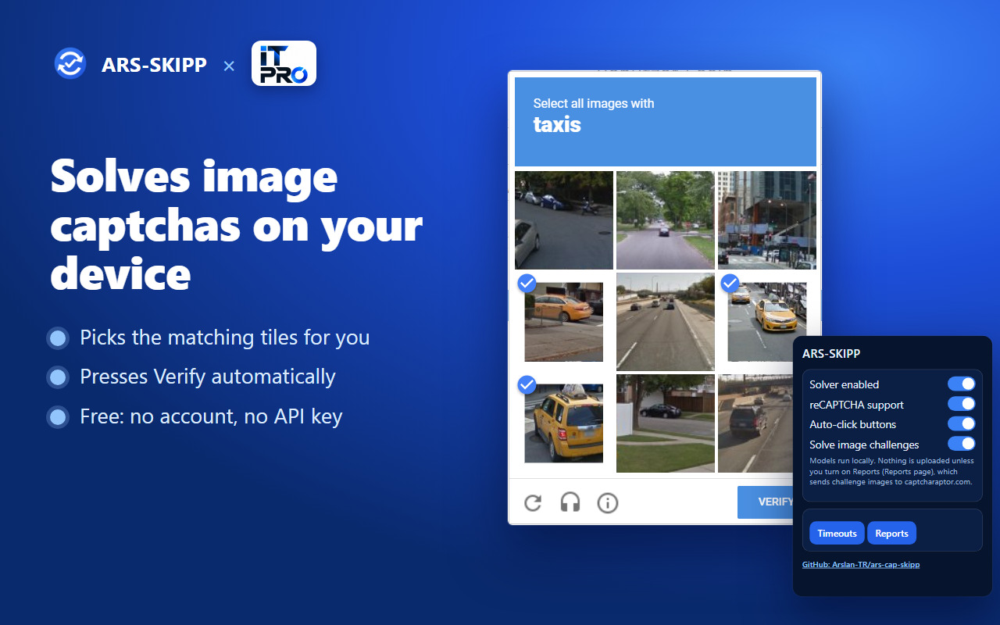
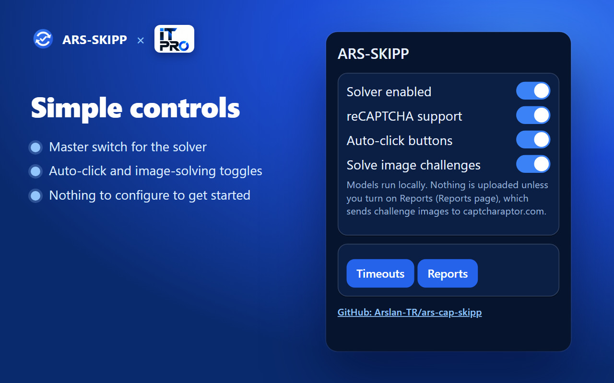
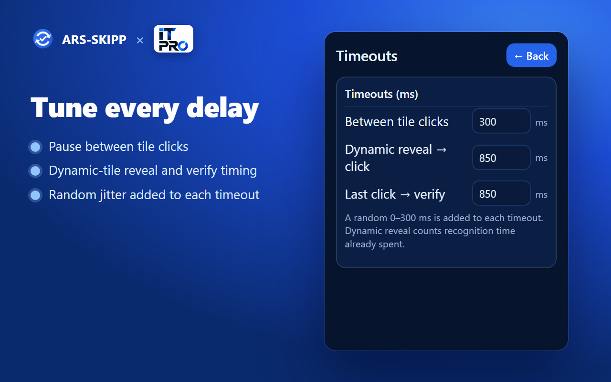
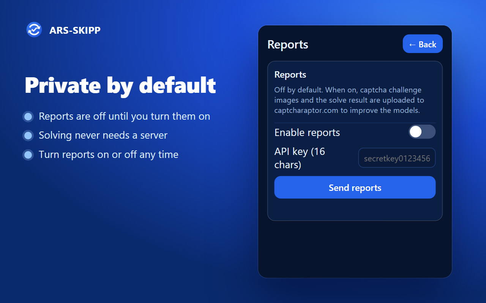
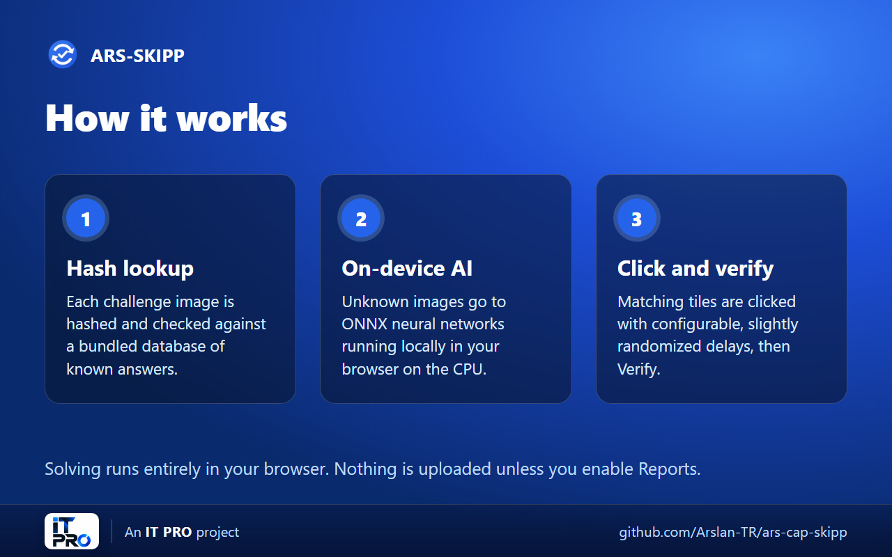

# ARS-SKIPP — Free AI ReCaptcha Solver

**English** | [Türkçe](README.tr.md)

[](LICENSE)


GitHub: https://github.com/Arslan-TR/ars-cap-skipp

A Chrome extension that automatically solves reCAPTCHA image challenges using built-in ONNX neural networks that run on your own CPU, inside the browser. Free — no API key or registration is needed for the base extension.

## Table of contents

- [Screenshots](#screenshots)
- [Features](#features)
- [Supported challenges](#supported-challenges)
- [Requirements](#requirements)
- [Installation](#installation)
- [Usage](#usage)
- [Configuration](#configuration)
- [How it works](#how-it-works)
- [Project structure](#project-structure)
- [Data collection and privacy](#data-collection-and-privacy)
- [WS addon](#ws-addon)
- [Troubleshooting](#troubleshooting)
- [License](#license)

## Screenshots

<p align="center">
  
</p>

| Popup | Timeouts |
|-------|----------|
|  |  |

| Reports (off by default) | How it works |
|--------------------------|--------------|
|  |  |

## Features

- Solves reCAPTCHA v2 image challenges (3×3 and 4×4 grids) locally with on-device AI models.
- Opens the reCAPTCHA checkbox automatically and starts solving without user interaction.
- Perceptual-hash cache: a bundled SQLite database (`extension/db/captcha.sqlite`) of known image hashes with verified answers is checked before running inference, which improves both speed and accuracy.
- Configurable delays with random jitter so clicks do not happen at fixed intervals.
- Per-site disable list.
- Blue dark popup UI, translated into 11 languages (ar, de, en, es, fr, id, ja, ms, pt, ru, zh).
- Runs only on `*.google.com/recaptcha/*` and `*.recaptcha.net/recaptcha/*` frames.

## Supported challenges

The multi-class grid model (`models/grid.onnx`) recognises these object types:

`bicycles`, `buses`, `chimney`, `crosswalks`, `hydrants`, `motorcycles`, `parking meters`, `stairs`, `taxis`, `tractors`, `traffic lights`

A dedicated `motorcycles_b1` model is bundled for the motorcycle 4×4 case. `models/type.onnx` handles tile-by-tile classification for 3×3 challenges.

## Requirements

- Google Chrome 111 or newer (or another Chromium browser with Manifest V3 support).
- About 110 MB of disk space (models and WASM runtimes are bundled).
- On first start the extension can pause for 5–15 seconds while the models load.

## Installation

### Base extension (Chrome 111+)

1. Clone or download this repository:
   ```bash
   git clone https://github.com/Arslan-TR/ars-cap-skipp.git
   ```
2. Open `chrome://extensions`.
3. Enable **Developer mode** (top-right toggle).
4. Click **Load unpacked**.
5. Select the `extension/` folder.
6. Restart the browser if the solver does not react after installation.

### WS addon (Chrome 116+, optional)

The WS addon adds WebSocket-based remote control for automated pipelines. It is installed on top of the base extension. See [`ws-addon/README.md`](ws-addon/README.md).

## Usage

1. Open any page that shows a reCAPTCHA.
2. With the defaults the extension clicks the checkbox and solves the image challenge by itself.
3. Click the extension icon to turn individual features on or off:

| Popup switch | What it does |
|--------------|--------------|
| Solver enabled | Master on/off switch |
| reCAPTCHA support | Enables handling of reCAPTCHA frames |
| Auto-click buttons | Clicks the checkbox and the Verify button automatically |
| Solve image challenges | Runs the AI models on image challenges |
| WS mode | Remote-control mode (only visible with the WS addon and a 32-character key) |

The popup also has **Timeouts** and **Reports** pages and a link to this repository.

## Configuration

Open the **Timeouts** page in the popup:

| Setting | Default | Description |
|---------|---------|-------------|
| Between tile clicks | 300 ms | Pause between clicking individual tiles (3×3 only) |
| Dynamic reveal → click | 850 ms | Pause from a new dynamic tile image appearing to clicking it (counts recognition time already spent) |
| Last click → verify | 850 ms | Pause between the final tile click and pressing Verify |
| Disabled sites | — | Hostnames where the extension is inactive |

A random 0–300 ms jitter is added to each timeout every time it fires. Tiles in a 3×3 challenge are clicked in randomized order.

## How it works

1. A MAIN-world content script (`eventhook/loader.js`) wraps the page's `addEventListener` so synthetic interaction is accepted; a second content script (`eventhook.js`, `captcha/recaptcha.js`) reads the challenge UI inside reCAPTCHA frames.
2. Each challenge image is perceptually hashed (`captcha/phash-browser.js`) and looked up in the bundled SQLite cache via `sql.js`. A cache hit returns the verified answer without running inference.
3. On a cache miss the images are passed to ONNX models running in the browser through `onnxruntime-web` (WASM, CPU): `models/type.onnx` decides whether each tile contains the target object (3×3); `models/grid.onnx` scores each tile position (4×4).
4. The matching tiles are clicked, then Verify is pressed after the configured delay.
5. Encountered images and their answers are stored in IndexedDB and periodically uploaded to a remote server (see below).

## Project structure

```
ARS-SKIPP/
├── extension/                 Base Manifest V3 extension (load this folder)
│   ├── manifest.json
│   ├── background.js          Service worker, storage, report bookkeeping
│   ├── background_sqlite.js   SQLite cache access
│   ├── uploader.js            Dataset uploader (reports)
│   ├── captcha/               Challenge detection, pHash, AI inference
│   ├── eventhook/, eventhook.js  Event hooks for reCAPTCHA frames
│   ├── lib/                   sql.js (SQLite in WASM)
│   ├── libs/onnxruntime-web/  ONNX Runtime Web
│   ├── models/                grid.onnx, type.onnx, motorcycles_b1.onnx (+ meta)
│   ├── db/captcha.sqlite      Known image hashes with verified answers
│   ├── popup.html/css/js      Popup UI
│   ├── reports.html/js        Reports page
│   ├── ws/background_ws.js    WS stub (replaced by the addon)
│   ├── _locales/              11 UI translations
│   └── icon/                  Blue extension icons
├── ws-addon/                  Optional WebSocket remote-control overlay
├── LICENSE
├── README.md                  This file (English)
└── README.tr.md               Turkish version
```

## Data collection and privacy

Please read this before installing.

- **Reports are off by default (opt-in).** Solving runs entirely on your machine and nothing is uploaded.
- If you turn reports on (popup → **Reports** → **Enable reports**), the extension uploads challenge images, selected tiles and the solve outcome, stored in IndexedDB, periodically to `captcharaptor.com` (the original upstream project's server) to grow its training dataset.
- A random reporting key is generated per browser profile and stored locally. It is not tied to an account. When reports are on, the key is sent to the server with each upload (as an `X-Auth-Key` header and in the request URL).
- The popup text states this: it says models run locally and that nothing is uploaded unless Reports is enabled.
- While reports are on, pages with reCAPTCHA you solve may be part of an upload, so avoid using the extension on pages whose content you consider private.

## WS addon

`ws-addon/` overlays the base extension with a WebSocket client so the extension can act as a personal captcha-solving worker for tasks in 2captcha / AntiCaptcha format. It requires Chrome 116+, extra permissions (`tabs`, `debugger`, `offscreen`, all URLs) and an API key from the upstream CaptchaPlugin service. Details: [`ws-addon/README.md`](ws-addon/README.md).

> The addon connects to `wss://ws.captcharaptor.com`. The server's client token is no longer hard-coded: you must store your own in `chrome.storage.local` under `ws_auth_token` (see [`ws-addon/README.md`](ws-addon/README.md)). Without it the addon does not connect. Treat the addon as third-party remote-control code and install it only if you understand that.

## Troubleshooting

| Problem | Fix |
|---------|-----|
| Nothing happens after install | Restart the browser; check `chrome://extensions` for errors on the service worker |
| First solve is slow | Models are loading (5–15 s). Later solves are faster |
| reCAPTCHA is not in English | The extension forces English because the models only understand English labels |
| Does not run on a site | Check the **Disabled sites** list and that the switches in the popup are on |
| Memory use is high | The three ONNX models are large; close other heavy tabs |

## License

MIT — see [LICENSE](LICENSE). The original copyright notice (Raptor) is kept as the license requires.

Repository: https://github.com/Arslan-TR/ars-cap-skipp
